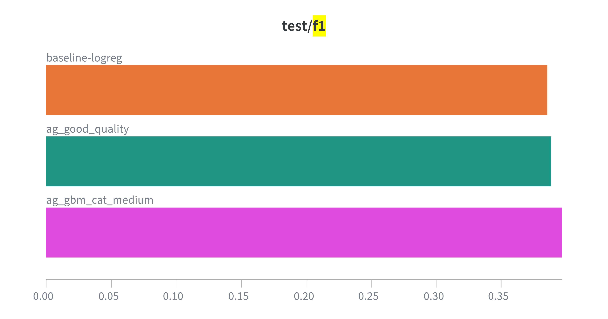
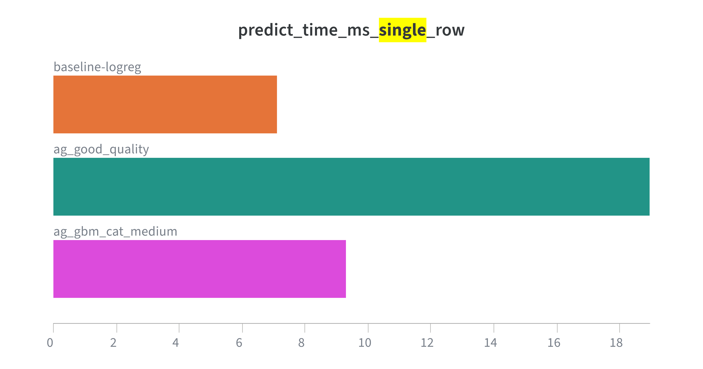
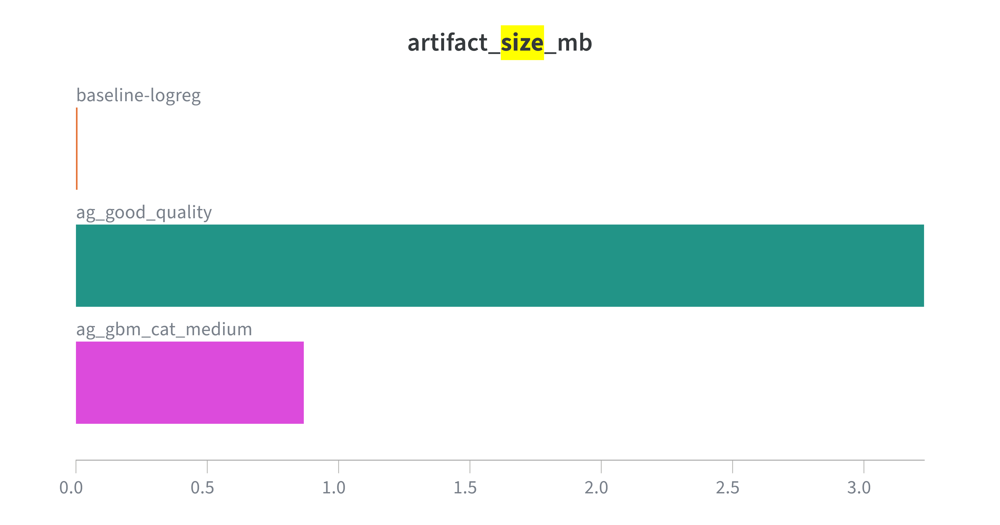
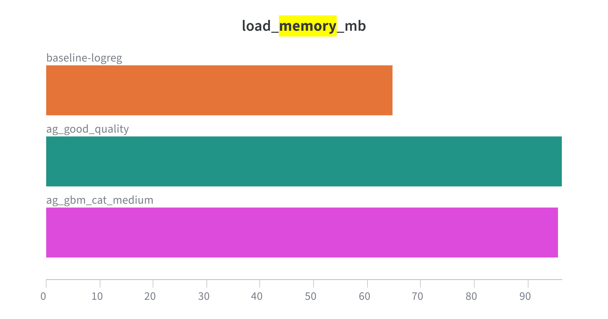

# ADR-2: Wybór modelu produkcyjnego i jego postać jako artefaktu

- **Status:** proponowany
- **Sprint:** S3
- **Autor:** Tadeusz Kucza-Kuczyński
- **Recenzent:**

## Kontekst

W Sprincie 3 porównaliśmy baseline ze Sprintu 1-2 z dwoma konfiguracjami AutoGluona
uruchamianymi w pipeline'ie Kedro (`data_science`) i logowanymi do W&B
(projekt `asi-projekt`, grupa `sprint3`). Musimy zdecydować:

1. który model trafia dalej jako `production`;
2. w jakiej postaci go przekazujemy, żeby API w Sprincie 4 mogło go wczytać bez treningu
   i bez wiedzy o tym, jak był trenowany.

Dane: `online_shoppers` (12 330 sesji), target `Revenue`, klasa pozytywna `true`
(sesja zakończona zakupem, ok. 15,5% rekordów). Split `stratified_random`,
`test_size=0.2`, `random_state=42`. Metryka główna: F1 dla klasy pozytywnej.

## Rozważone opcje

1. **`baseline-logreg`** - sklearn `Pipeline` (preprocessing + `LogisticRegression`) z ADR-1.
2. **`ag_gbm_cat_medium`** - AutoGluon, preset `medium_quality`, tylko LightGBM i CatBoost,
   z limitem czasu; najlepszy model wewnętrzny `WeightedEnsemble_L2`.
3. **`ag_good_quality`** - AutoGluon, preset `good_quality` (bagging), z limitem czasu;
   najlepszy model wewnętrzny `LightGBMXT_BAG_L1_FULL`.

### Kryteria wyboru

1. F1 na zbiorze testowym (metryka główna kontraktu).
2. Koszt obsługi w API: czas predykcji 1 wiersza, rozmiar artefaktu, pamięć po wczytaniu,
   czas zimnego startu (wczytanie + 1. predykcja).
3. Czas treningu - tylko pomocniczo, bo trening nie jest na ścieżce API.

Model nie musi mieć najwyższego F1, jeśli inny jest wyraźnie tańszy we wdrożeniu przy
porównywalnej jakości.

## Decyzja

**Do produkcji trafia `ag_gbm_cat_medium`.**

Wyniki z runów W&B (20.11.2026, pełne dane), te same wartości co w
[`docs/model_comparison.md`](../model_comparison.md):

| Wielkość | baseline-logreg | **ag_gbm_cat_medium** | ag_good_quality | Skąd pochodzi |
|---|---|---|---|---|
| F1 (test) | 0.3852 | **0.3962** | 0.3882 | W&B `test/f1` |
| Precision | 0.2593 | **0.2953** | 0.2948 | W&B `test/precision` |
| Recall | 0.7487 | 0.6021 | 0.5681 | W&B `test/recall` |
| Predykcja 1 wiersza [ms] | 7.09 | 9.29 | 18.95 | W&B `predict_time_ms_single_row` |
| Predykcja zbioru test [ms] | 15.38 | 21.24 | 99.71 | W&B `predict_time_ms_batch` |
| Rozmiar artefaktu [MB] | 0.01 | 0.87 | 3.23 | W&B `artifact_size_mb` |
| Pamięć po wczytaniu [MB] | 64.79 | 95.64 | 96.38 | W&B `load_memory_mb` |
| Zimny start [s] | 1.88 | 3.61 | 5.16 | W&B `cold_start_s` |
| Czas treningu [s] | - | 65.80 | 319.82 | W&B `fit_seconds` |

Raport W&B z wykresami:
[ADR-2: Wybór modelu produkcyjnego](https://forge.coreweave.com/wandb/Projekt-ASI/asi-projekt/reports/ADR-2-Wyb-r-modelu-produkcyjnego--VmlldzoxODM1MjM4OA)

| F1 | Predykcja 1 wiersza |
|---|---|
|  |  |
| **Rozmiar artefaktu** | **Pamięć po wczytaniu** |
|  |  |

Na wykresach czasu, rozmiaru i pamięci krótszy słupek oznacza lepszy wynik.

### Uzasadnienie

- `ag_gbm_cat_medium` ma najwyższe F1 (0.3962) i najwyższą precision (0.2953).
- Względem baseline zyskujemy +0.011 F1 i +0.036 precision (mniej fałszywych alarmów)
  kosztem +2.2 ms na wiersz, +0.86 MB artefaktu, +31 MB pamięci i +1.7 s zimnego startu.
  Dla API obsługującego pojedyncze żądania te koszty są pomijalne.
- `ag_good_quality` jest gorszy we wszystkich kryteriach: niższe F1, 2x wolniejsza
  predykcja wiersza, 4.7x wolniejsza predykcja zbioru, 3.7x większy artefakt i 5x dłuższy
  trening. Droższy preset nie dał zysku jakości.

### Postać artefaktu

Model przekazujemy dalej jako **pakiet modelu**, a nie jako run czy notebook:

```text
model-package/            # W&B Artifact, type=model, alias: production
├── model/                # TabularPredictor po clone_for_deployment (tylko model do predykcji)
└── metadata.json         # cechy wejściowe, target, klasa pozytywna, metryki,
                          # git SHA, fingerprint danych, wersje bibliotek
```

- Zapis i odczyt wyłącznie przez wspólne funkcje z `src/asi_project/model_package.py`
  (`save_model_package`, `load_model_package`, `download_production_package`) -
  te same w Kedro, w smoke teście i w API.
- Dalsza część systemu wskazuje model aliasem `model-package:production`, a nie numerem
  runu czy wersji. Zmiana modelu produkcyjnego = przeniesienie aliasu na nową wersję.

## Odrzucone alternatywy

- **`ag_good_quality`** - zdominowany przez `ag_gbm_cat_medium` (gorszy w każdym kryterium).
- **`baseline-logreg`** - najtańszy we wdrożeniu, ale najniższe F1 i precision.
- **Pojedynczy plik `joblib` zamiast katalogu pakietu** - nie działa dla AutoGluona,
  który zapisuje predyktor jako katalog i wczytuje go przez `TabularPredictor.load`.
- **Wskazywanie modelu przez id runu** - wiązałoby API z konkretnym eksperymentem;
  alias `production` pozwala podmienić model bez zmian w kodzie usługi.

## Konsekwencje

- **Ułatwia:** API (Sprint 4) potrzebuje tylko `load_model_package` i aliasu `production`;
  schemat wejścia bierze z `metadata.json`.
- **Utrudnia:** obraz API musi zawierać `autogluon.tabular` - będzie większy niż przy
  baseline (do uwzględnienia w ADR-3).
- **Ryzyko:** przewaga F1 nad baseline (+0.011) pochodzi z jednego splitu 80/20 bez CV.
  Jeśli w kolejnych runach zniknie, wracamy do baseline jako tańszego modelu
  i aktualizujemy ten ADR.

## Historia

| Data | Zmiana |
|---|---|
| 2026-11-23 | utworzenie |
